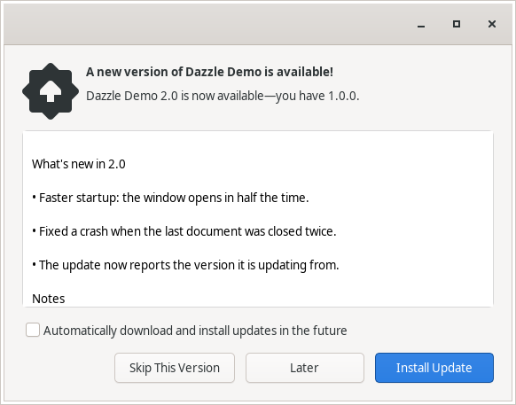
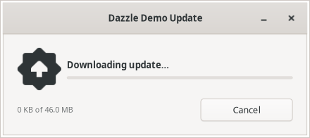
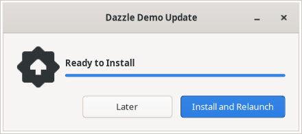
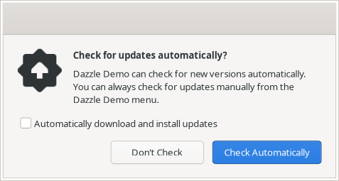
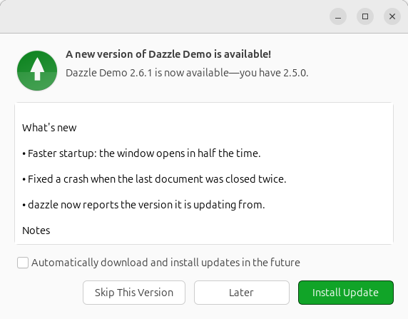

# UpdaterUI example

A host application for the built-in update windows: a small window of its own, a "Check
for Updates…" action, and `UpdaterUI`'s three windows on top of it. It is the example for
[specs/updater-ui.md](../../../specs/updater-ui.md) on both platforms that have the
built-in windows — an AppKit application bundle on macOS (`main.mm`), a GTK 4 application
directory on Linux (`main_linux.cpp`).

| File | Platform |
|---|---|
| `main.mm` | macOS: an `NSApplication`, its menu, and its own window |
| `main_linux.cpp` | Linux: a `GtkApplication`, and its own window |
| `demo.sh` | macOS: a local signed feed, run end to end |
| `demo_linux.sh` | Linux: the same, around an application directory |
| `DazzleDemo.icns` | the icon the macOS windows show |

## Run it

```bash
# anything macOS: `make demo`, or
cd core && ./examples/updater_ui_example/demo.sh

# on Linux (needs a desktop session; `make demo-linux`)
cd core && ./examples/updater_ui_example/demo_linux.sh
```

Both scripts build a throwaway copy of the application, write the feed URL and the public
key into it — an `Info.plist` on macOS, a `dazzle-demo.conf` beside the binary on Linux —
serve a signed 2.0.0 package of the same application at a higher version, and run it.
Clicking through **Install Update → Install and Relaunch** replaces the copy in place and
starts it again, and the copy that comes back reports 2.0.0.

On Linux the application is a directory (the executable plus whatever sits beside it), so
the demo copies the binary into its own directory and the release is a zip holding that
directory at a higher version.

| Available | Downloading | Ready | Permission |
|---|---|---|---|
|  |  |  |  |

*Built and run on a remote Ubuntu 24.04 host (GTK 4.14): the Available window is the real
one — a real signed release index over HTTP, the real notes, and the real buttons; the
other three were rendered by
[`core/tools/updater_ui_preview`](../../tools/updater_ui_preview/README.md), which can
draw every state without a desktop session and is how these pictures were taken. The
download, install and restart behind them are covered by
`core/tests/linux_install_e2e.sh`.*



*The same Available window rendered inside the host's own GNOME session on Wayland: the
accent colour, the header buttons and the fonts are the system's (this desktop's accent is
green), which is what "GTK 4's own controls, following the theme" looks like.*

## What the Linux windows are

GTK 4's own controls — `GtkWindow` and `GtkHeaderBar`, `GtkLabel`, `GtkButton`,
`GtkCheckButton`, `GtkProgressBar`, and a read-only `GtkTextView` for the notes — so the
look, the dark theme, the accent colour, the fonts and accessibility come from the theme
rather than from dazzle's own drawing. `specs/updater-ui.md` has the metrics and the two
Linux-only differences: the windows are drawn on the application's own GTK main loop, and
the compositor places them (Wayland does not let a client set a window's position).
