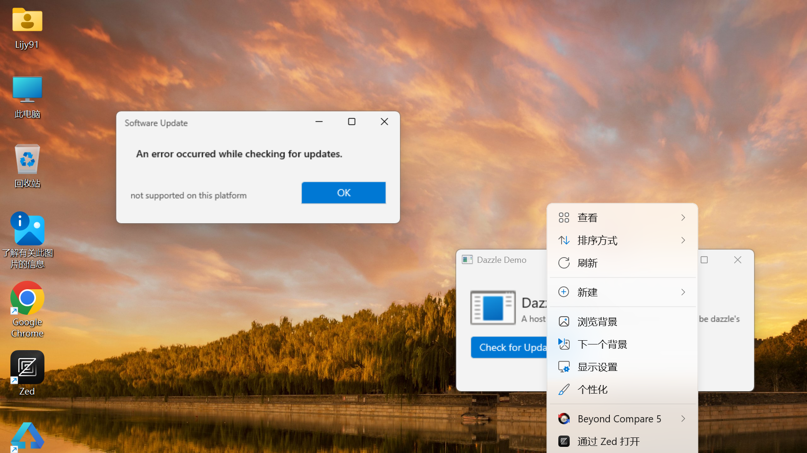
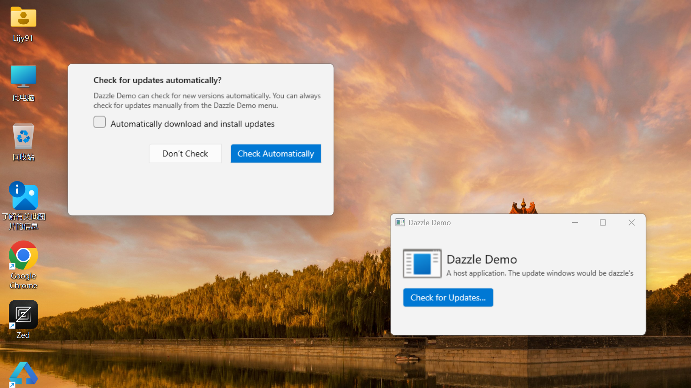

# WinUI 3 updater UI example

A host application for dazzle's update windows on Windows. **The windows are the module's**:
`core/src/platform/windows/updater_ui_backend_winui3.cpp` implements the same `UiBackend`
seam macOS (AppKit) and Linux (GTK 4) implement, driven by the shared state machine, the
shared content builder and core's own wording — Simplified Chinese included. This example is
what an application that uses that module looks like: its own name, its own window, and one
call.

```
App.xaml / App.xaml.cs   the application: hands the module its XAML thread, pumps, checks
HostWindow.cs            the host window: the application's name and "Check for Updates…"
Core.cs                  every touch of the generated C# binding, in one place
Startup.cs               the log, and what core answers through the C ABI at startup
WinUI3UpdaterUiExample.csproj
```

The project reference is what builds `core/` with CMake; a plain reference beside it is what
makes the binding a runtime asset of this app (`CopyLocalLockFileAssemblies`).

## Build and run

Needs the .NET SDK (9 or 8), CMake, and — for the first restore — network access to NuGet:
the Windows App SDK, the Windows SDK build tools and `System.Drawing.Common` are
`PackageReference`s. Nothing has to be installed: the app is **unpackaged**
(`WindowsPackageType=None`) and **self-contained** (`WindowsAppSDKSelfContained=true`), so the
Windows App Runtime travels in the output.

```powershell
dotnet build WinUI3UpdaterUiExample.csproj -c Release
.\bin\Release\net9.0-windows10.0.26100.0\win-x64\DazzleUiExample.exe
```

`DAZZLE_DEMO_CHECK=1` makes the host check on launch, `DAZZLE_DEMO_CHECK=background` makes it
check silently (which is what shows the permission question the first time), and
`DAZZLE_WINDOWS_UI_LOG=1` makes the Windows backend write what it did to
`%TEMP%\dazzle-winui3-backend.log`. The app's own log is `%TEMP%\dazzle-winui3-example.log`.

### On a remote machine

With the [`remote-hosts`](../../.agents/skills/remote-hosts/SKILL.md) skill, GUI work needs
`--gui`: the plain SSH session is Windows session 0, where nothing can create a window.

```bash
R=.agents/skills/remote-hosts/scripts/remote.py
$R win-box setup
$R win-box run --gui --timeout 1800 build.ps1     # dotnet build → CMake builds core/ → the app
$R win-box run --gui --timeout 300 run.ps1        # starts the .exe and captures the screen
$R win-box pull winui3-<state>.png ./            # the capture, back here
```

Building core on Windows needs the Windows App SDK payload and C++/WinRT's projections:
`core/src/CMakeLists.txt` finds the component packages under the NuGet global packages
folder, generates the projections with the newest Windows SDK's `cppwinrt`, and links
`windowsapp.lib` and the components' native libraries. It leaves the backend file out when
the payload is not there, exactly as Linux does without GTK 4 — and then the cross-platform
backend answers that this build has no windows.

## What the host must do, and why

XAML in a process belongs to the thread that started the `Application`. Windows that the
module creates on a thread of its own are answered with `RPC_E_WRONG_THREAD` (or worse), so:

- the backend draws on the thread that calls it, and treats that thread as the windows'
  thread — which is the host's UI thread by construction;
- a state the state machine reaches on another thread (an update that failed to check, a
  download that finished) is kept and drawn when the host pumps — `UpdaterUI.Pump()`, which
  this example calls from a 100 ms `DispatcherTimer`;
- `UpdaterUI.SetDispatcherQueue(handle)` exists for a host that wants to state which thread
  it means; a handle that crossed the C ABI as a projected object's `IUnknown` is a CCW and
  calling into it re-enters the CLR, which is what this backend does *not* do.

## The windows, as rendered on a Windows 11 host

| Checking / Error (status window) | Permission (its own window) |
|---|---|
|  |  |

*(`winui3-checking.png` is the same status window in its earlier state.)*

## Known limits

- **No icon yet.** `AppIcon()` returns null: the GDI-to-`WriteableBitmap` conversion it wants
  is the one piece of these windows that would be our own interop rather than XAML.
- **The Available window needs data.** On Windows the updater cannot fetch anything — core has
  no HTTP implementation for Windows — so a real check ends in the Error state, which is what
  the screenshot shows. Showing Available needs the release index to come from somewhere
  local; that is a design decision for `Updater` (a "the index is in hand" entry point) rather
  than anything the window code is missing.
- **`core/tools/updater_ui_preview` is macOS-only.** Its Windows counterpart — a scripted
  driver for every state — is not written; that is the other way to photograph Available.
