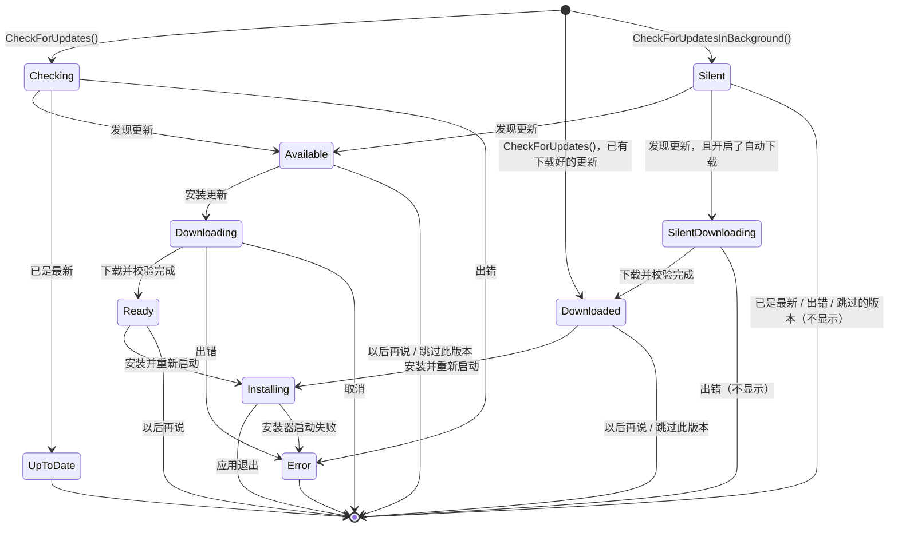

# UpdaterUI：内置更新界面

[Updater](updater.md) 不带 UI，界面由应用自己画。`UpdaterUI` 是给不想自己画界面的应用准备的
可选模块：用原生界面带用户走完"检查 → 查看更新说明 → 下载 → 安装并重启"的全过程。
它只是 Updater 的一个使用者，所有数据和动作都来自 Updater，不增加新的更新逻辑。

两种用法可以并存，但同一时刻只走一条流程：`UpdaterUI` 进行中时，应用直接调用 Updater 的
动作会得到 `"another operation is in progress"`，反之亦然。

## 目标与边界

- 原生外观：macOS 用 AppKit 的系统控件；Windows 用 Win32 窗口，控件按 Windows 11 的 Fluent 规格
  自绘（见"外观"）。不用 WebView，不引入 UI 框架。
- 一行代码接入：配好 Updater 的数据源和公钥，菜单项里调用 `CheckForUpdates()` 即可。
- 任何 UI 框架的应用都能用（Flutter、Qt、Electron、原生），不要求应用配合事件循环。

目前界面由两个更新窗口和一个只出现一次的询问窗口组成（见"窗口与流程"）。模块名不叫 window，是为以后留出其它形式的界面，
例如后台检查发现更新时改用系统通知（macOS 通知中心、Windows toast），而不必改名。

**暂不包含**（后续再设计）：系统通知、定时自动检查的调度、"退出时安装"、匿名系统信息上报、
自定义文案和配色、自定义窗口内容、Linux 与移动端界面。

**不做**：独立的"正在解压"阶段。Sparkle 在下载后先解压再进入 Ready；dazzle 的签名校验在
`DownloadUpdate()` 里完成，macOS 的解压发生在 `InstallUpdate()` 里（见 [updater.md](updater.md)），
解压的时间已经包含在 Installing 里，没有可以单独显示的步骤。

## 公共接口

新模块，`src/updater_ui.h`：

```cpp
class UpdaterUI {
 public:
  static UpdaterUI& GetInstance();

  // 用户发起的检查（"检查更新…"菜单项）：立即显示窗口并进入"正在检查"，走完整流程；
  // 已是最新、出错都会在窗口里告诉用户。已有更新窗口在显示时，只把它带到前台。
  // 返回 false 表示本平台没有内置界面。
  bool CheckForUpdates();

  // 静默检查（应用启动时、应用自己的定时器）：只在发现更新时显示窗口；
  // 已是最新、出错、或发现的是用户跳过的版本时什么都不显示。已有更新窗口在显示时什么都不做。
  // 用户关闭了自动检查时直接返回；用户还没回答过时先显示询问窗口（见"首次询问"）。
  // 返回 false 表示本平台没有内置界面。
  bool CheckForUpdatesInBackground();

  // 是否有更新窗口正在显示。应用可据此禁用"检查更新…"菜单项。
  bool IsVisible() const;

  // 窗口文案里使用的应用名。默认取自平台：macOS 为主 bundle 的 CFBundleName，
  // Windows 为主程序 VERSIONINFO 的 ProductName。SetAppName("") 恢复默认。
  void SetAppName(const std::string& name);
  std::string GetAppName() const;

  // 用户是否同意自动检查更新：为 false 时 CheckForUpdatesInBackground() 什么都不做。
  // 用户在询问窗口里的回答、应用在自己的设置界面里的修改都落到这里；调用过 Set 就不再询问。
  void SetAutomaticChecksEnabled(bool enabled);
  bool IsAutomaticChecksEnabled() const;

  // 静默检查发现更新时是否先在后台下载，下载完成再显示窗口（见"自动下载"）。默认 false。
  void SetAutomaticDownloadsEnabled(bool enabled);
  bool IsAutomaticDownloadsEnabled() const;

  // 应用是否允许自动下载。为 false 时窗口里不出现自动下载的复选框，
  // IsAutomaticDownloadsEnabled() 恒为 false。默认 true。
  void SetAutomaticDownloadsAllowed(bool allowed);
  bool IsAutomaticDownloadsAllowed() const;
};
```

- 生成的 C ABI 为 `dazzle_updater_ui_check_for_updates()` 等；binding 中为
  `UpdaterUI.instance.checkForUpdates()`（Dart）、`UpdaterUI::instance().check_for_updates()`
  （Rust）、`UpdaterUI.Instance.CheckForUpdates()`（C#）。
- 数据源、当前版本、公钥全部沿用 Updater 的配置，`UpdaterUI` 不重复提供。

## 用户偏好

Updater 不持久化任何状态；`UpdaterUI` 要记住三件属于用户的事，存在平台的用户偏好里，
随应用走、按用户隔离：

| 偏好 | 含义 | macOS（`NSUserDefaults` 标准域） | Windows（`HKCU\Software\{公司名}\{应用名}\dazzle`） |
|---|---|---|---|
| 自动检查 | 未回答 / 是 / 否 | `DazzleAutomaticChecks` | `AutomaticChecks`（DWORD，缺省为未回答） |
| 自动下载 | 是 / 否 | `DazzleAutomaticDownloads` | `AutomaticDownloads`（DWORD） |
| 跳过的版本 | 版本号或无 | `DazzleSkippedVersion` | `SkippedVersion`（字符串） |

公司名、应用名取自主程序 VERSIONINFO 的 CompanyName、ProductName。

典型用法：

```cpp
dazzle::ReleaseIndexSource::GetInstance().SetUrl("https://example.com/myapp/releases.json");
dazzle::Updater::GetInstance().SetPublicKey("pfIShU4dEXqPd5ObYNfDBiQWcXozk7estwzTnF9BamQ=");

// 应用启动后：
dazzle::UpdaterUI::GetInstance().CheckForUpdatesInBackground();

// "检查更新…"菜单项：
dazzle::UpdaterUI::GetInstance().CheckForUpdates();
```

## 线程

- 所有方法**任意线程可调用，立即返回**，不阻塞调用方。这一点对 Flutter 尤其重要：Dart 代码
  不一定运行在平台主线程上。
- 模块内部自己调度：Updater 的阻塞动作在模块自己的工作线程上执行；界面操作切到平台的 UI 线程——
  macOS 投递到主线程（`dispatch_async(dispatch_get_main_queue(), ...)`），Windows 由模块自己的
  UI 线程创建窗口并运行消息循环，不依赖、也不干扰应用的消息循环。
- 这是 dazzle 里唯一自带线程的模块；Updater 本身仍然没有线程（见 [updater.md](updater.md)）。

## 窗口与流程

更新流程由两个窗口承载，按常见更新框架的分法划分（Sparkle 的 `SUUpdateAlert` / `SUStatusController`、
NetSparkle 的 `UpdateAvailableWindow` / `DownloadProgressWindow`、AutoUpdater.NET 的
`UpdateForm` / `DownloadUpdateDialog`）：

| 窗口 | 负责的状态 | 布局 |
|---|---|---|
| **UpdateAvailableWindow** | Available、Downloaded | 应用图标与版本信息、可滚动的更新说明、自动下载复选框、按钮；可调整大小 |
| **UpdateStatusWindow** | Checking、Downloading、Ready、Installing、UpToDate、Error | 应用图标、一行状态或进度条、按钮；固定大小的紧凑布局 |

另有 **UpdatePermissionWindow**，只在首次静默检查前出现一次（见"首次询问"），不参与下面的状态机。

- 同一时刻最多显示一个窗口。流程在两个窗口之间转换时（Checking → Available、Available → Downloading），
  先显示新窗口再关闭旧窗口，新窗口以旧窗口的中心为中心，看起来是原地替换。
- 同一窗口内的状态转换（例如 Downloading → Ready）只更新窗口内容，不重建窗口。
- 两个窗口都非模态、不依附于应用的任何窗口，显示时带到前台。不另外弹出对话框：已是最新、
  出错也显示在 UpdateStatusWindow 里。



| 状态 | 窗口 | 窗口内容 | 按钮 | 调用的 Updater 方法 |
|---|---|---|---|---|
| Checking | Status | 不确定进度条，"正在检查更新…" | 取消 | `CheckForUpdates()` |
| Available | Available | 应用图标；"{应用名} 有新版本可用"；"{应用名} {新版本} 已发布，你当前使用的是 {当前版本}。"；可滚动的更新说明；复选框"以后自动下载并安装更新" | 跳过此版本 ··· 以后再说 · **安装更新** | `GetUpdateDisplayVersion()`、`GetUpdateReleaseNotes()` 等 |
| Downloaded | Available | 同 Available，标题为"{应用名} 的新版本已准备好安装"，说明为"{应用名} {新版本} 已下载完成。要现在安装并重新启动 {应用名} 吗？" | 跳过此版本 ··· 以后再说 · **安装并重新启动** | `IsUpdateDownloaded()` |
| Downloading | Status | 确定进度条，"已下载 12.3 MB / 46.0 MB"；总大小未知时为不确定进度条 | 取消 | `DownloadUpdate()`；每 100 ms 读 `GetDownloadProgress()`；取消时 `CancelDownload()` |
| Ready | Status | "更新已准备就绪" | 以后再说 · **安装并重新启动** | — |
| Installing | Status | "正在安装…"（很短） | 无 | `InstallUpdate()`，成功后退出应用（见下） |
| UpToDate | Status | "{应用名} {当前版本} 已是最新版本。" | **好** | — |
| Error | Status | 标题按步骤："检查更新时出错" / "下载更新时出错" / "安装更新时出错"；说明按 `GetErrorCode()` 取文案（见"错误文案"），附 `GetErrorMessage()` 作为详细信息 | **好** | — |

- Checking 状态的"取消"只关闭窗口：Updater 的检查不可中断，工作线程上的检查会跑完，结果被丢弃；
  在它结束前再次调用 `CheckForUpdates()` 会重新显示窗口并沿用这次检查。
- 粗体为默认按钮（回车触发）；Esc 与关闭窗口等同于"以后再说"或"取消"。
- 下载中关闭窗口视为取消。Ready、Downloaded 状态下选"以后再说"，已下载的文件在本次进程内保留：
  之后调用 `CheckForUpdates()` 直接显示 Downloaded，不重新检查（重新检查会让 Updater 清空结果）；
  `CheckForUpdatesInBackground()` 什么都不做。进程退出后不保留，这是 Updater"状态不持久化"的直接结果。
- 复选框"以后自动下载并安装更新"对应 `SetAutomaticDownloadsEnabled()`，勾选即写入用户偏好，
  不需要等用户点按钮；`IsAutomaticDownloadsAllowed()` 为 false 时不显示。
- 更新说明为空但有 `GetUpdateReleaseNotesUrl()` 时，UpdateAvailableWindow 显示"查看更新说明"链接，
  用系统浏览器打开，此时没有更新说明区域，窗口为固定大小。
- Installing 状态没有按钮，窗口也不能关闭。

### 跳过此版本

- "跳过此版本"把这次更新的版本号（`GetUpdateVersion()`）写入用户偏好，然后关闭窗口；
  Downloaded 状态下还会丢弃已下载的文件。
- `CheckForUpdatesInBackground()` 发现的版本等于跳过的版本时，什么都不显示；比它新的版本照常提示，
  并清除跳过记录。
- `CheckForUpdates()` 是用户主动的，不受跳过影响：跳过的版本照常显示为 Available。

### 自动下载

`IsAutomaticDownloadsEnabled()` 为 true 时，`CheckForUpdatesInBackground()` 发现更新（且不是跳过的
版本）后不显示窗口，在工作线程上直接 `DownloadUpdate()`；下载并校验完成才显示 UpdateAvailableWindow
的 Downloaded 状态，用户看到的第一个窗口就是"安装并重新启动"。下载出错时什么都不显示。

### 首次询问

用户还没回答过"是否自动检查"时，`CheckForUpdatesInBackground()` 不检查，先显示 UpdatePermissionWindow：

| 内容 | 按钮 |
|---|---|
| 应用图标；"要自动检查更新吗？"；"{应用名} 可以自动检查新版本。你随时可以在 {应用名} 菜单中手动检查更新。"；复选框"自动下载并安装更新"（`IsAutomaticDownloadsAllowed()` 为 false 时不显示） | 不检查 · **自动检查** |

- "自动检查"：写入 `SetAutomaticChecksEnabled(true)` 和复选框的值，然后继续这次静默检查。
- "不检查"或关闭窗口：写入 `SetAutomaticChecksEnabled(false)`，这次和以后的静默检查都什么都不做。
- `CheckForUpdates()` 不询问：用户主动检查，本身就是回答。
- 应用在询问前调用过 `SetAutomaticChecksEnabled()` 的，不再询问。

## 错误文案

Error 状态的说明按 Updater 的 `GetErrorCode()`（见 [updater.md](updater.md)）取本地化文案，
`GetErrorMessage()` 的英文原文附在其后，供用户反馈问题时复制：

| 错误码 | 文案 |
|---|---|
| `network` | 无法连接到更新服务器。请检查网络连接后再试。 |
| `invalid-index` | 更新信息的格式不正确。请稍后再试，或联系开发者。 |
| `signature` | 更新包的签名无效，已停止安装。请稍后再试，或联系开发者。 |
| `permission` | 没有权限替换 {应用名}。请在"系统设置 → 隐私与安全性 → App 管理"中允许 {应用名} 修改应用（macOS），或以有权限的账户运行。 |
| `app-location` | {应用名} 正在从只读或临时位置运行，无法原地更新。请将它移到"应用程序"文件夹，从那里重新打开后再试。 |
| `installer` | 无法启动安装程序。请稍后再试。 |
| 其它 | 发生了未知错误。请稍后再试。 |

## 退出应用

`InstallUpdate()` 返回 true 后必须尽快退出进程。Updater 把这件事留给应用；`UpdaterUI` 为了
"一行接入"，自己发起平台标准的**正常退出**，让应用有机会保存状态：

| 平台 | 做法 |
|---|---|
| macOS | 主线程调用 `[NSApp terminate:nil]`，走应用的 `applicationShouldTerminate:` 流程 |
| Windows | 向本进程所有可见顶层窗口（本模块的除外）发送 `WM_CLOSE` |

如果应用拒绝退出（例如用户在"是否保存"对话框里点了取消），安装器会一直等到进程退出后再替换应用。

## 更新说明的渲染

`GetUpdateReleaseNotes()` 是 Markdown。渲染只支持常见子集：标题、段落、有序/无序列表、粗体、
斜体、行内代码、代码块、链接。链接点击后用系统浏览器打开；不加载任何远程资源（图片不显示）。

| 平台 | 做法 |
|---|---|
| macOS | Markdown → HTML → `NSAttributedString`（`initWithHTML:`），显示在只读 `NSTextView` 中 |
| Windows | Markdown → RTF，显示在只读 RichEdit 控件（`msftedit.dll`，系统自带）中；深色时用 `EM_SETBKGNDCOLOR` 与字符格式设置配色 |

Markdown 解析用 md4c（`core/third_party/`，单文件、MIT），HTML/RTF 输出由 dazzle 自己实现。
两个平台都不需要 WebView。

## 本地化

窗口文案内置英文和简体中文，跟随系统首选语言，其它语言回退到英文。文案表放在跨平台层
（`src/updater_ui_strings.*`），两个平台共用同一份。自定义文案以后再设计。

## 外观

- macOS：标准 `NSWindow`，系统控件，自动跟随浅色/深色模式。应用图标取 `[NSApp applicationIconImage]`。
  - UpdateAvailableWindow：`Titled | Closable | Resizable`（没有更新说明区域时不加 `Resizable`），
    内容区默认 532 × 370 pt，更新说明区域最小高 200 pt。
  - UpdateStatusWindow：`Titled | Closable`，内容区宽 400 pt，高约 107 pt。
  - UpdatePermissionWindow：`Titled`，内容区宽 440 pt，高随内容。
  - 尺寸与间距参照 Sparkle 的同类窗口：64 pt 应用图标，四周 20 pt 边距，更新说明区域为 6 pt 圆角、
    1 pt 分隔线边框。
- Windows：Win32 顶层窗口，窗口内的控件（按钮、复选框、进度条、链接）不用 Common Controls，
  而是由 dazzle 用 Direct2D + DirectWrite 自绘，外观取 WinUI 3 的 Fluent 规格。Common Controls v6
  在 Windows 11 上是旧式外观，且没有公开的深色模式支持；自绘才能与系统其它部分一致并跟随深浅色。
  - 规格以 microsoft-ui-xaml 的主题资源为准（`Common_themeresources_any.xaml`、
    `Button_themeresources.xaml`、`CheckBox_themeresources.xaml`、`ProgressBar_themeresources.xaml`）：
    按钮高 32、内边距 11,5,11,6、圆角 4，填充 `ControlFillColorDefault`，边框为 `ControlElevationBorder`
    （底边 `ControlStrokeColorSecondary`）；默认按钮用 `AccentFillColorDefault`；复选框 20 × 20、圆角 4，
    未勾选描边 `ControlStrongStrokeColorDefault`；进度条轨道 1、指示条 3；正文 Segoe UI Variable 14px。
  - 强调色取系统强调色；深浅色读 `HKCU\…\Themes\Personalize\AppsUseLightTheme`，收到
    `WM_SETTINGCHANGE`（`ImmersiveColorSet`）时重绘。
  - 标题栏交给 DWM：`DWMWA_USE_IMMERSIVE_DARK_MODE` 跟随深浅色；Windows 11 22H2 起用
    `DWMWA_SYSTEMBACKDROP_TYPE` 开启 Mica，更早的系统用纯色背景（浅色 `#F3F3F3`、深色 `#202020`）。
  - 自绘控件自己实现键盘焦点、Tab 顺序和焦点框，并为每个控件提供 UI Automation 提供程序，
    使读屏软件能读到按钮、复选框和进度。
  - 按窗口所在显示器的 DPI 缩放（Per-Monitor V2）。应用图标取主程序的第一个图标资源。
- 窗口标题：UpdatePermissionWindow 为"软件更新"；UpdateAvailableWindow 为"{应用名} 更新"；UpdateStatusWindow 在 Checking/UpToDate/Error
  时为"软件更新"，在 Downloading/Ready/Installing 时为"{应用名} 更新"。

## 平台可用性

`CheckForUpdates()` 与 `CheckForUpdatesInBackground()` 的注释带 `@note Platform availability:` 块：

| 平台 | 可用 | 说明 |
|---|---|---|
| macOS | ✅ | AppKit |
| Windows | ✅ | Win32 窗口 + Direct2D 自绘控件 |
| Linux | ❌ | Updater 在 Linux 上不能安装，完整流程走不通 |
| iOS | ❌ | 应用应引导用户去 App Store / TestFlight |
| Android | ❌ | |
| OHOS | ❌ | |

❌ 的平台返回 false，不显示任何东西。

## 实现分层

```
src/updater_ui.h / .cpp         公共类、状态机、工作线程、调用 Updater
src/platform/<os>/updater_ui_preferences_<os>.*   用户偏好的读写（NSUserDefaults、注册表）
src/updater_ui_strings.*        文案表（en、zh-Hans）
src/markdown/                      md4c 之上的 HTML、RTF 输出
src/platform/<os>/updater_ui_<os>.*   UpdaterUI::Impl：两个窗口、切换窗口与状态内容、退出应用
```

- 状态机在跨平台层：它决定"下一步调用 Updater 的哪个方法、显示哪个状态"，平台层只负责
  "把这个状态画出来"和"把按钮点击报回来"。状态属于哪个窗口是固定的（见上表），由平台层据此
  选择窗口，状态机不需要知道窗口的存在。这样两个平台的流程行为保证一致。
- `Impl` 接口大致为：`ShowState(state, content)`、`SetProgress(fraction, text)`、`Hide()`、
  `QuitApplication()`，以及把按钮事件回传给状态机的回调。它不是公共 API，可以用 `std::function`。
- 六个平台目录都要有 `updater_ui_<os>` 文件；Linux 与移动端为返回 false 的桩。
- 链接依赖：macOS 增加 `-framework AppKit`；Windows 增加 `user32`、`gdi32`、`shell32`、`d2d1`、`dwrite`、
  `dwmapi`、`uiautomationcore`。
  只用 Updater 的应用也会链接到这些系统库，但不会加载任何界面，直到调用 `UpdaterUI`。

## 落地步骤

前提：[updater.md](updater.md) 的 macOS 实现已完成。

1. 跨平台层：状态机与文案表，用一个记录调用的假 `Impl` 做单元测试（覆盖每条状态转换）。
2. Markdown → HTML / RTF 输出 + 单元测试。
3. `updater_ui.h` 加入 `API_HEADERS`，`./codegen` 重新生成；六个平台先全部留桩。
4. macOS 实现；`flutter_updater_example` 增加"检查更新…"按钮走内置界面。
5. Windows 实现。
6. 各 binding 的示例补上内置界面的用法。
